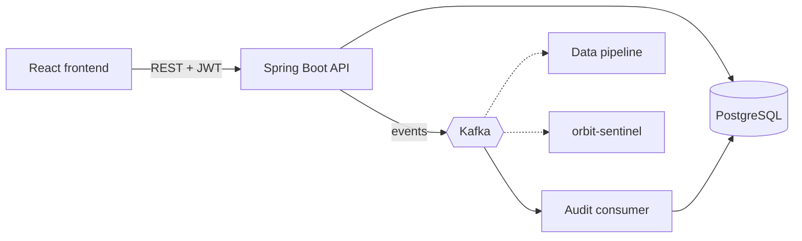

# Orbit: graduate application tracker

An event-driven system that keeps every job application, deadline and reply in one place, and helps you
decide what to do next. Built because opportunities kept getting buried in a noisy inbox.

**Status:** core tracker, audit trail, CV match and posting risk check are built. Cloud deployment, data
pipeline, calendar planner, email detection and offline mode are planned. See the
[task board](docs/TASK_BOARD.md).

<!-- Add a screenshot and a short demo GIF here: docs/img/demo.gif -->

## What it does

| Feature | Status |
|---|---|
| Register / sign in (BCrypt + JWT) | Built |
| Track applications across 8 stages (wishlist to offer) | Built |
| "Finish these first" panel for unsent applications closing soon | Built |
| Audit trail from Kafka events | Built |
| CV match: keywords from a job description that your CV is missing | Built (rules-based) |
| Posting risk check: common scam signals with reasons | Built (rules-based) |
| Free-time finder for focus blocks | Logic built, Google Calendar not connected |
| Cloud deployment (AWS, Terraform) | Planned |
| Data pipeline (bronze / silver / gold) and dashboard | Planned |
| Gmail job-email detection | Planned |
| Offline mode (PWA) | Planned |

## Architecture



More diagrams (data model, sequence, UML) are in [`docs/`](docs/architecture.md) and [`docs/uml/`](docs/uml).
Decisions and trade-offs are recorded in [`docs/decisions/`](docs/decisions).

## Tech stack

Java 21, Spring Boot 3.3 (Web, Data JPA, Security, Validation, Actuator), Spring for Apache Kafka,
PostgreSQL 16 with Flyway migrations, JWT (jjwt), React 18 + Vite, Docker Compose, GitHub Actions.

## Run it

You need Docker.

```bash
cp .env.example .env        # then edit the values; never commit .env
docker compose up --build
```

- App: http://localhost:3000
- API: http://localhost:8080 (health: `/actuator/health`)

### Develop without Docker for the app itself

```bash
docker compose up postgres kafka        # infrastructure only
export DB_PASSWORD=change-me JWT_SECRET=$(openssl rand -base64 48)
cd backend && mvn spring-boot:run       # API on :8080
cd frontend && npm install && npm run dev   # UI on :5173
```

### Tests

```bash
cd backend && mvn verify
```

Unit tests cover the CV match rules, risk rules and the free-slot finder. Integration tests with
Testcontainers are the next task on the board.

## API

All routes except `/api/auth/**` need `Authorization: Bearer <token>`.

| Method | Path | Purpose |
|---|---|---|
| POST | `/api/auth/register`, `/api/auth/login` | Get a token |
| GET, POST | `/api/applications` | List, create |
| GET, PUT, DELETE | `/api/applications/{id}` | Read, update, delete |
| GET | `/api/applications/due-soon?days=14` | Unsent applications closing soon |
| GET | `/api/audit` | Last 50 events for the signed-in user |
| POST | `/api/tools/match` | CV vs job description keyword match |
| POST | `/api/tools/risk` | Scam-signal check for a posting |

## Project structure

```
backend/    Spring Boot API (config, auth, user, application, events, tools, planner)
frontend/   React + Vite UI
docs/       Architecture, UML (PlantUML), decisions (ADRs), task board
.github/    CI workflow, issue and pull request templates
```

PlantUML files in `docs/uml/` render in IntelliJ, VS Code (PlantUML extension) or at plantuml.com.
The Mermaid diagrams render directly on GitHub.

## Security notes

- Passwords are BCrypt hashed. Every query is scoped to the signed-in user.
- `JWT_SECRET` and database credentials come from environment variables, never from the repo.
- The CV match and risk check run on the server and send nothing to third parties.
- The token is in `localStorage` for now, which is weaker than an httpOnly cookie (on the task board).

## Limitations (honest list)

- CV match is keyword overlap. It does not predict how any real applicant tracking system ranks you.
- The risk check reports signals, not proof. Always confirm a company on its own website and CIPC.
- Events are published after the database write, not atomically (transactional outbox is planned).
- No refresh tokens yet; you sign in again after an hour.

## Author

Vanessa Botsime, [github.com/vanessa-botsime](https://github.com/vanessa-botsime)

Licensed under MIT (see `LICENSE`).
