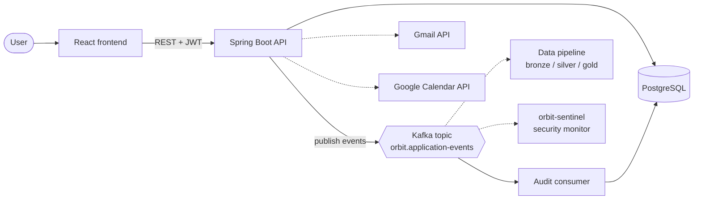
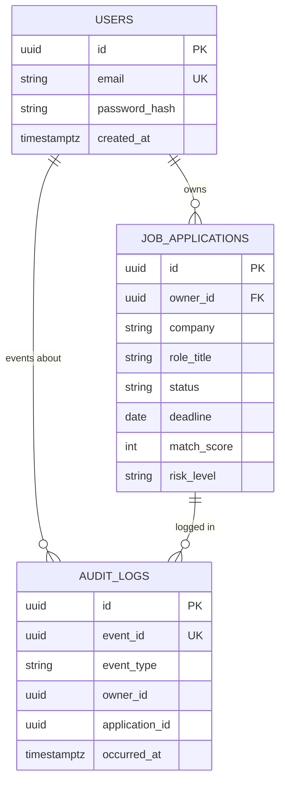
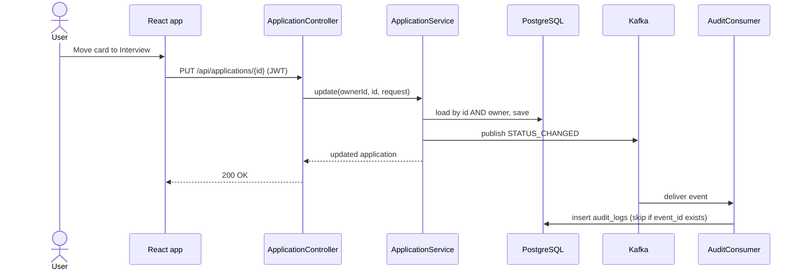

# Architecture

## System overview

Solid lines exist in the repo. Dotted lines are planned (see `TASK_BOARD.md`).

## Data model

## Request flow: changing an application's status

## Package layout (backend)

| Package | Responsibility |
|---|---|
| `config` | JWT service and filter, security rules, CORS |
| `auth`, `user` | Registration, login, user entity |
| `application` | Application CRUD, due-soon query, status rules |
| `events` | Event record, Kafka publisher, audit consumer and log |
| `tools` | CV match and posting risk checks |
| `planner` | Free-slot logic for focus blocks (Calendar API pending) |
